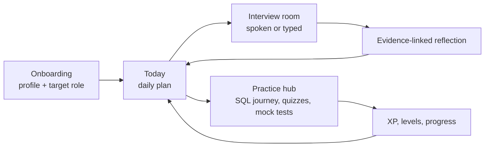

# MIRROR Interview Studio

The working product prototype for MIRROR: interview preparation where you practise out loud and on real problems, then get told plainly what landed and what to work on next.

> *Walk in knowing what you will say, and having already done the hard parts once.*

## Problem

Candidates for data, analytics and product roles prepare alone and blind. Practice is scattered across coding sites, flashcards and friends; question banks check the answer but not the idea; nothing is tailored to the job they are interviewing for; and motivation fades without visible progress. The full problem framing is in [`docs/MIRROR-PRD.md`](docs/MIRROR-PRD.md).

## Approach

One place to prepare: it learns who you are and the role you are targeting, guides you day by day, and covers spoken answers, technical skills (SQL first) and timed mock rounds.



## What exists today

- Landing page, first-interview onboarding and a daily "Today" home screen.
- Interview room for spoken or typed answers, with pause, continue-later and end-session handling.
- Targets for specific jobs and a story bank of the candidate's own examples.
- SQL practice built as a guided, game-style journey: animated lessons, about 440 write-a-query questions, 68 concept questions and timed mock tests, run in the browser with `sql.js`.
- Text interviews persist through a Hono API; voice uses Sarvam speech when a key is configured.

**Honest status:** the product runs in a demo workspace without real accounts, and real-microphone voice testing is still pending. Section 14 of the PRD lists what has been checked in a browser and the known gaps.

## Tech stack

React 19, TypeScript, Vite, Tailwind CSS, Radix UI · Hono API on Node (`server/`) · Supabase (auth and data) · NVIDIA NIM (LLM) · Sarvam (speech) · sql.js · Vitest

## Run locally

```bash
npm install
cp .env.example .env     # optional: Supabase, NVIDIA NIM, Sarvam
npm run dev              # web app, port 3000
npm run dev:server       # API, port 8787 (memory mode by default)
```

Without NVIDIA or Supabase credentials the API runs in memory mode with catalogue follow-ups, and reflection generation returns a retryable provider error. Without `SARVAM_API_KEY`, voice is off and the learner types. Every variable is documented in `.env.example`.

| Command | What it does |
| --- | --- |
| `npm run build` | Type-check and production build |
| `npm test` | Vitest suite (UI copy, routing, server API) |
| `npm run typecheck:server` | Server-only TypeScript check |
| `npm run smoke` | In-process API smoke test |

## Repository

```text
src/            Screens (pages/), practice, prep, stories, targets, voice, UI system
server/         Hono API: auth, routes, domain logic, providers, voice
supabase/       Database migrations
docs/           PRD, design system, flows, SQL curriculum, research
roast-room/     Vendored decision-review tool (MIT, AI Automation Society), used for product critiques
```

## Product notes

- Feedback is tied to the candidate's own words, not a generic score.
- SQL comes first because it is the most common technical screen for the target roles and the easiest to check automatically.
- Design and copy principles live in `docs/DESIGN.md` and `docs/DESIGN-PHILOSOPHY.md`.
